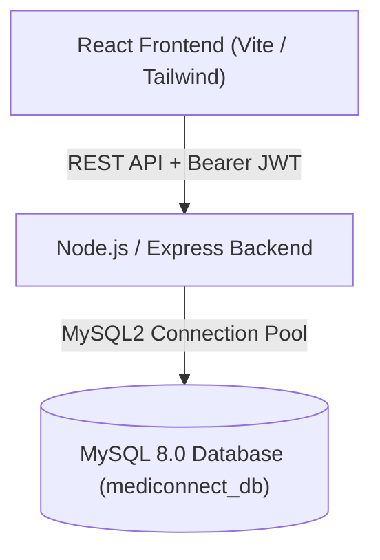

# MediConnect — Emergency Blood Donation & Healthcare Coordination Platform

MediConnect is a full-stack, enterprise-grade healthcare web application designed to coordinate voluntary blood donations, donor assessments, laboratory infection screening, clinical release authorization, blood component inventory, and emergency hospital transfusion requests.

---

## 1. System Architecture

MediConnect is engineered as a secure, decoupled three-tier application:

- **Frontend Tier:** React 18 SPA built with Vite, Tailwind CSS, Lucide icons, and React Router v6.
- **Backend API Tier:** Node.js + Express.js REST API with JWT authentication, server-side RBAC, Zod schema validation, and audit logging.
- **Database Tier:** MySQL 8.0 relational database (`mediconnect_db`) normalized in 3rd Normal Form (3NF) with InnoDB engine, row-level locks (`FOR UPDATE`), and ACID transactions.



---

## 2. Database Schema (13 Tables)

| # | Table | Purpose |
| :- | :--- | :--- |
| 1 | `users` | Platform accounts, bcrypt password hashes, and RBAC roles |
| 2 | `donors` | Voluntary donor registry linked to authenticated user accounts |
| 3 | `donor_assessments` | Pre-donation vitals, Hb screening, and DGHS clinical eligibility |
| 4 | `donor_deferrals` | Temporary and permanent donor deferral tracking |
| 5 | `blood_donations` | Accessioned donation units, quarantine status, and barcodes |
| 6 | `blood_components` | Fractionated blood components (PRBC, FFP, Platelets) and cold-chain storage |
| 7 | `screening_test_catalogue` | Statutory screening test master catalogue (HIV, HBV, HCV, Syphilis, Malaria) |
| 8 | `laboratory_test_results` | Screening test results, kit lots, and automated Bio-Lock triggers |
| 9 | `clinical_reviews` | Authorized Transfusion Medicine Officer release dispositions |
| 10 | `emergency_requests` | Urgent hospital blood requisitions, urgency levels, and fulfillment tracking |
| 11 | `campaigns` | Community blood donation camps and voluntary collection drives |
| 12 | `confidential_follow_ups` | Confidential counseling and confirmatory referral for reactive donors |
| 13 | `audit_logs` | Immutable audit trail for all security, clinical, and inventory events |

---

## 3. Platform Roles & Demo Accounts

All demo accounts use the standard development password: **`Password@123`**

| Role | Demo Email | Primary Responsibilities |
| :--- | :--- | :--- |
| **Administrator** | `admin@mediconnect.local` | System administration, audit logs, catalogue configuration, user management |
| **Blood Bank Staff** | `staff.rohit@mediconnect.local` | Donor health assessment, phlebotomy accessioning, component derivation |
| **Lab Technician** | `lab.anita@mediconnect.local` | Mandatory TTI screening execution, test result entry, lot number logging |
| **Clinical Reviewer** | `dr.priya.tmo@mediconnect.local` | Transfusion Medicine Officer release authorization, bio-lock reviews |
| **Donor** | `rahul.donor@mediconnect.local` | Profile management, donor onboarding, donation history, matching emergency requests |
| **Hospital Coordinator** | `coord.vikram@cityhospital.local` | Emergency blood request submission, urgency prioritization, fulfillment tracking |

---

## 4. Getting Started & Installation

### Prerequisites
- Node.js (v18 or higher)
- MySQL 8.0 Server running on `127.0.0.1:3306`

### Step 1: Clone Repository & Install Dependencies
```bash
git clone https://github.com/yuvrajsinghsoni06-dotcom/MediConnect.git
cd MediConnect

# Install frontend dependencies
npm install

# Install backend dependencies
cd backend && npm install && cd ..
```

### Step 2: Database Setup
1. Create the database in MySQL:
   ```sql
   CREATE DATABASE IF NOT EXISTS mediconnect_db;
   ```
2. Configure credentials in `backend/.env` (copy from `backend/.env.example`).
3. Run migrations and seed data:
   ```bash
   cd backend
   node db/migrate.js
   node db/seed.js
   cd ..
   ```

### Step 3: Run Development Servers
```bash
# Terminal 1: Start Backend API (http://localhost:5000)
cd backend && npm start

# Terminal 2: Start Frontend Application (http://localhost:3000)
npm run dev
```

---

## 5. Testing & Verification

MediConnect includes end-to-end integration and unit test suites:

```bash
# Run Backend Integration Tests (43 tests covering all APIs, RBAC, and safety safeguards)
npm run test:backend

# Run Frontend Unit & Component Tests (40 Vitest tests)
npm test -- --run

# Run Server Startup and Live MySQL Verification
node backend/tests/serverStartupCheck.js

# Build Frontend for Production
npm run build
```

---

## 6. Safety & Security Safeguards

- **Strict Server-Side Medical Rules:** 
  - DGHS India vital signs rules (Hb >= 12.5 g/dL, weight >= 45 kg, BP, pulse).
  - Release strictly blocked unless all 5 mandatory screening tests (HIV, HBV, HCV, Syphilis, Malaria) are Non-Reactive.
  - Automated **Bio-Lock** quarantine engaged immediately on any Reactive screening result.
- **Zero Plaintext Passwords:** All passwords hashed with `bcrypt`.
- **Foreign Key Safe Audit Logging:** Failed unauthenticated attempts log `actor_user_id = NULL` to prevent foreign key violations.
- **Donor Privacy Shield:** Public donor discovery APIs strictly filter out phone numbers, email addresses, and exact dates of birth.
- **SQL Injection Defense:** 100% parameterized SQL prepared statements.

---

## 7. Documentation Index

- [API & Schema Documentation](file:///c:/Users/1000/OneDrive/Documents/dbms%20capstone/docs/api-documentation.md)
- [Deployment Readiness Guide](file:///c:/Users/1000/OneDrive/Documents/dbms%20capstone/docs/DEPLOYMENT_READINESS.md)
- [Authoritative Medical Reference Data](file:///c:/Users/1000/OneDrive/Documents/dbms%20capstone/docs/medical-references/authoritative-reference-data.md)
- [Implementation Mapping](file:///c:/Users/1000/OneDrive/Documents/dbms%20capstone/docs/medical-references/implementation-mapping.md)
