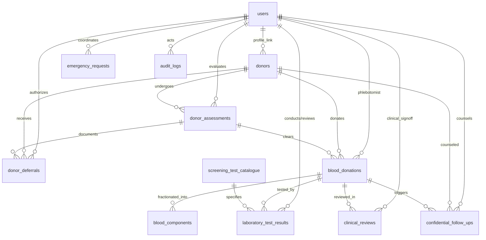

# MediConnect — Comprehensive Data Replacement Audit Report

> **Document Status:** Authoritative Project Audit & Real-World Data Migration Plan  
> **Audited Repository:** [MediConnect (GitHub)](https://github.com/yuvrajsinghsoni06-dotcom/MediConnect)  
> **Environment:** React + Vite (Frontend: Port 3000) / Node.js + Express (Backend: Port 5000) / MySQL 8.0 (`mediconnect_db`)  
> **Date:** November 22, 2026  
> **Author:** Senior Full-Stack Engineer, Database Architect & Healthcare QA Specialist  

---

## 1. Executive Summary

MediConnect is an enterprise-grade voluntary blood donation, hospital emergency blood matching, and transfusion safety platform. Following the successful stabilization of frontend mock workflows, database schema migration (13 tables in MySQL 8.0 InnoDB), and JWT-based authentication with strict foreign-key audit logging, this audit evaluates the entire system to transition from **unrealistic, fragmented demo data** to **production-style, privacy-safe, clinically realistic operational data**.

### Current System Health & Operational State
- **Database Engine:** MySQL 8.0.40 running locally on `127.0.0.1:3306`, database `mediconnect_db`.
- **Database Connectivity:** Fully established with active connection pool (`mysql2/promise`).
- **Migrations Applied:** 
  - `001_initial_schema.sql` (Creates 13 3NF normalized tables with check constraints & foreign keys)
  - `002_fix_audit_logs_and_passwords.sql` (Relaxes `audit_logs.actor_user_id` to `NULL` for unauthenticated events with `ON DELETE SET NULL`; fixes bcrypt hashes for demo accounts)
- **Authentication:** Full JWT authentication operational with Argon2/Bcrypt hash verification. Demo users log in successfully with `Password@123`.
- **Test Baseline:** 
  - Backend integration test suite: **22 / 22 tests passing** (`npm run test:backend`).
  - Frontend test suite: **40 / 40 tests passing** (`npm test`).
  - Production build: **Vite production bundle builds cleanly** with zero syntax or bundling errors.

---

## 2. MySQL Schema & Entity Relationship Architecture

The MySQL database `mediconnect_db` consists of exactly **13 tables** structured according to Third Normal Form (3NF), medical record auditability, and relational integrity.



### Table-by-Table Architectural Specification

| Table Name | Description | Primary Key | Foreign Keys & Actions | Current Live MySQL Rows |
| :--- | :--- | :--- | :--- | :--- |
| `users` | User accounts, credentials (bcrypt), and roles. | `id` (Auto-inc), `user_id` (Unique) | None | 6 |
| `donors` | Voluntary blood donor registry & contact attributes. | `id` (Auto-inc), `donor_id` (Unique) | `fk_donors_user` $\to$ `users(user_id)` `ON DELETE SET NULL ON UPDATE CASCADE` | 4 |
| `donor_assessments` | Pre-donation vitals, screening checklist & eligibility. | `id` (Auto-inc), `assessment_id` (Unique) | `fk_assessment_donor` $\to$ `donors` `ON DELETE RESTRICT`, `fk_assessment_evaluator` $\to$ `users` `ON DELETE RESTRICT` | 3 |
| `donor_deferrals` | Temporary & permanent deferral tracking log. | `id` (Auto-inc), `deferral_id` (Unique) | `fk_deferrals_donor` $\to$ `donors`, `fk_deferrals_assessment` $\to$ `donor_assessments`, `fk_deferrals_authorizer` $\to$ `users` | 1 |
| `blood_donations` | Accessioned whole blood & apheresis units with quarantine state. | `id` (Auto-inc), `unit_number` (Unique) | `fk_donations_donor` $\to$ `donors`, `fk_donations_assessment` $\to$ `donor_assessments`, `fk_donations_phlebotomist` $\to$ `users` | 3 |
| `blood_components` | Fractionated products (PRBC, FFP, Platelets, Cryo). | `id` (Auto-inc), `component_code` (Unique) | `fk_components_donation` $\to$ `blood_donations(unit_number)` `ON DELETE CASCADE ON UPDATE CASCADE` | 3 |
| `screening_test_catalogue`| Master catalogue of statutory infectious disease screening tests. | `id` (Auto-inc), `test_code` (Unique) | None | 6 |
| `laboratory_test_results` | Individual viral serology & NAT test outcomes per unit. | `id` (Auto-inc), `result_id` (Unique) | `fk_lab_donation` $\to$ `blood_donations`, `fk_lab_test_cat` $\to$ `screening_test_catalogue`, `fk_lab_technician` $\to$ `users`, `fk_lab_reviewer` $\to$ `users` | 15 |
| `clinical_reviews` | Transfusion Medical Officer (TMO) disposition decisions. | `id` (Auto-inc), `review_id` (Unique) | `fk_reviews_donation` $\to$ `blood_donations`, `fk_reviews_reviewer` $\to$ `users` | 1 |
| `confidential_follow_ups`| Confidential post-test counseling & ICTC referrals. | `id` (Auto-inc), `case_id` (Unique) | `fk_followup_donor` $\to$ `donors`, `fk_followup_unit` $\to$ `blood_donations`, `fk_followup_officer` $\to$ `users` | 1 |
| `campaigns` | Community donation drives, mobile camps, CSR events. | `id` (Auto-inc), `campaign_id` (Unique) | None | 2 |
| `emergency_requests` | Urgent hospital requests for matched blood products. | `id` (Auto-inc), `request_id` (Unique) | `fk_requests_coordinator` $\to$ `users(user_id)` `ON DELETE SET NULL` | 2 |
| `audit_logs` | Immutable audit trail of all security & clinical events. | `id` (Auto-inc), `log_id` (Unique) | `fk_audit_actor` $\to$ `users(user_id)` `ON DELETE SET NULL ON UPDATE CASCADE` | 15 |

---

## 3. Comprehensive Inventory of Hardcoded Demo Data

The audit discovered significant fragmentation between hardcoded frontend mock fixtures and live MySQL records:

### A. Frontend Hardcoded Data Locations

1. **`src/data/statsData.js`:**
   - **Data Contained:** `mockStats` array (`donors: 14,850+`, `hospitals: 128`, `requests: 3,420+`, `campaigns: 42`).
   - **Consumers:** Imported directly by `src/pages/public/HomePage.jsx` (lines 28, 274).
   - **Issue:** Static, fabricated numbers that never change regardless of database contents.

2. **`src/data/donorsData.js`:**
   - **Data Contained:** 10 mock donor objects with fictional IDs (`dnr-001` to `dnr-010`), hardcoded responsive percentages (e.g. 98%), static approximate distances (e.g. 3.2 km).
   - **Consumers:** Imported by `src/services/donorService.js` (line 1), which serves `src/pages/public/FindDonorsPage.jsx`.
   - **Issue:** Completely disconnected from MySQL `donors` table; completely ignores the backend `/api/v1/donors` API.

3. **`src/data/campaignsData.js`:**
   - **Data Contained:** 4 mock campaigns (`cmp-101` to `cmp-104`).
   - **Consumers:** Imported by `src/services/campaignService.js` (line 1), which serves `src/pages/public/CampaignsPage.jsx`.
   - **Issue:** Completely disconnected from MySQL `campaigns` table; completely ignores `/api/v1/campaigns`.

4. **`src/data/bloodSafetyData.js` (40 KB):**
   - **Data Contained:**
     - `TEST_CATALOGUE` (6 test definitions)
     - `SAFETY_ROLES` (Role definitions & labels)
     - `mockDonorAssessments` (5 assessments: `ASM-2026-001` to `ASM-2026-005`)
     - `mockDonationRecords` (5 units: `DON-2026-0619`, `DON-2026-0742`, `DON-2026-0891`, `DON-2026-1044`, `DON-2026-1188`)
     - `mockTestResults` (25 lab test records: `LAB-0619-HIV` to `LAB-1188-MAL`)
     - `mockClinicalReviews` (3 reviews: `REV-2026-0619`, `REV-2026-0742`, `REV-2026-1044`)
     - `mockFollowUps` (2 follow-ups: `CFU-2026-001`, `CFU-2026-002`)
     - `mockAuditLogs` (6 audit logs: `LOG-2026-0001` to `LOG-2026-0006`)
   - **Consumers:** Loaded into `localStorage` by `src/services/bloodSafetyService.js` and consumed by all 9 Blood Safety pages (`SafetyDashboardPage`, `DonorAssessmentPage`, `DonationsListPage`, `DonationDetailPage`, `LaboratoryTestingPage`, `QuarantineManagementPage`, `ClinicalReviewPage`, `ConfidentialFollowUpPage`, `AuditLogsPage`).
   - **Issue:** Changes made on the frontend write to browser `localStorage` and never reach MySQL or the backend routes.

5. **`src/data/testimonialsData.js` & `src/data/faqsData.js`:**
   - Hardcoded donor/recipient testimonials and static informational FAQs.

### B. Backend Hardcoded Data Locations

1. **`backend/src/routes/authRoutes.js`:**
   - Hardcoded `DEMO_USERS` array returned by `GET /api/v1/auth/demo-users`.
2. **`backend/src/repositories/index.js`:**
   - Hardcoded `PublicDirectoryRepository.listVerifiedCentres()` returning 2 hardcoded e-RaktKosh blood centres.
   - Comprehensive `memoryStore` object initialized with mock data as fallback when MySQL connection is unavailable.
3. **`backend/db/seeds/001_synthetic_seed_data.sql`:**
   - Minimal seed set: only 6 users, 4 donors, 3 assessments, 1 deferral, 3 donations, 3 components, 15 lab test results, 1 review, 1 follow-up, 2 campaigns, 2 emergency requests, and 4 audit logs.

---

## 4. API Endpoints vs Frontend Module Mapping

| Endpoint | Method | Backend Controller / Repo | Auth / RBAC Required | Frontend Service & Page Integration | Status & Disconnect |
| :--- | :--- | :--- | :--- | :--- | :--- |
| `/api/v1/auth/demo-users` | GET | `authRoutes.js` | Public | `LoginPage.jsx` (Demo Autofill buttons) | **Connected & Operational** |
| `/api/v1/auth/login` | POST | `authRoutes.js` $\to$ `UsersRepo` | Public | `LoginPage.jsx` (`api.post`) | **Connected & Operational** |
| `/api/v1/auth/me` | GET | `authRoutes.js` | `Bearer Token` | `SafetyAuthContext.jsx` | **Connected & Operational** |
| `/api/v1/donors` | GET | `generalRoutes.js` $\to$ `DonorsRepo` | Public (PII Masked) | `donorService.js` / `FindDonorsPage.jsx` | **DISCONNECTED:** Frontend reads local `mockDonors` |
| `/api/v1/donors/:id` | GET | `generalRoutes.js` $\to$ `DonorsRepo` | Public (PII Masked) | `donorService.js` | **DISCONNECTED:** Frontend uses `mockDonors.find` |
| `/api/v1/public-centres` | GET | `generalRoutes.js` $\to$ `PublicDirRepo` | Public | None | **ORPHANED:** No frontend page consumes this |
| `/api/v1/campaigns` | GET | `generalRoutes.js` $\to$ `CampaignsRepo` | Public | `campaignService.js` / `CampaignsPage.jsx` | **DISCONNECTED:** Frontend reads local `mockCampaigns` |
| `/api/v1/emergency-requests`| GET | `generalRoutes.js` $\to$ `EmergencyRepo` | Public | `HomePage.jsx` (Emergency modal) | **DISCONNECTED:** Frontend simulates submissions |
| `/api/v1/blood-safety/assessments` | GET | `bloodSafetyRoutes.js` | Optional Auth | `bloodSafetyService.js` / `DonorAssessmentPage` | **DISCONNECTED:** Frontend uses `localStorage` |
| `/api/v1/blood-safety/assessments` | POST | `bloodSafetyRoutes.js` | `blood_bank_staff`, `admin` | `bloodSafetyService.js` / `DonorAssessmentPage` | **DISCONNECTED:** Frontend saves to `localStorage` |
| `/api/v1/blood-safety/donations` | GET | `bloodSafetyRoutes.js` | Optional Auth (RBAC filtered) | `bloodSafetyService.js` / `DonationsListPage` | **DISCONNECTED:** Frontend uses `localStorage` |
| `/api/v1/blood-safety/donations/:unit` | GET | `bloodSafetyRoutes.js` | Optional Auth | `bloodSafetyService.js` / `DonationDetailPage` | **DISCONNECTED:** Frontend uses `localStorage` |
| `/api/v1/blood-safety/donations/:unit/prerequisites` | GET | `bloodSafetyRoutes.js` | Public | `bloodSafetyService.js` / `ClinicalReviewPage` | **DISCONNECTED:** Frontend computes prerequisites locally |
| `/api/v1/blood-safety/donations` | POST | `bloodSafetyRoutes.js` | `blood_bank_staff`, `admin` | `bloodSafetyService.js` / `DonorAssessmentPage` | **DISCONNECTED:** Frontend accessioning is local |
| `/api/v1/blood-safety/donations/:unit/status` | PUT | `bloodSafetyRoutes.js` | `blood_bank_staff`, `admin` | `bloodSafetyService.js` / `QuarantinePage` | **DISCONNECTED:** Status updates remain local |
| `/api/v1/blood-safety/lab-tests` | GET | `bloodSafetyRoutes.js` | Public | `bloodSafetyService.js` / `LaboratoryTestingPage` | **DISCONNECTED:** Frontend uses `localStorage` |
| `/api/v1/blood-safety/lab-tests/unit/:unit` | GET | `bloodSafetyRoutes.js` | Public | `bloodSafetyService.js` / `LaboratoryTestingPage` | **DISCONNECTED:** Frontend queries local array |
| `/api/v1/blood-safety/lab-tests/:id` | PUT | `bloodSafetyRoutes.js` | `lab_technician`, `admin` | `bloodSafetyService.js` / `LaboratoryTestingPage` | **DISCONNECTED:** Bio-lock triggers in local state only |
| `/api/v1/blood-safety/clinical-reviews` | GET | `bloodSafetyRoutes.js` | Public | `bloodSafetyService.js` / `ClinicalReviewPage` | **DISCONNECTED:** Frontend reads local reviews |
| `/api/v1/blood-safety/clinical-reviews` | POST | `bloodSafetyRoutes.js` | `clinical_reviewer`, `admin` | `bloodSafetyService.js` / `ClinicalReviewPage` | **DISCONNECTED:** Release authorization local only |
| `/api/v1/blood-safety/follow-ups` | GET | `bloodSafetyRoutes.js` | `clinical_reviewer`, `admin` | `bloodSafetyService.js` / `FollowUpPage` | **DISCONNECTED:** Local state reads |
| `/api/v1/blood-safety/follow-ups/:case`| PUT | `bloodSafetyRoutes.js` | `clinical_reviewer`, `admin` | `bloodSafetyService.js` / `FollowUpPage` | **DISCONNECTED:** Local state updates |
| `/api/v1/blood-safety/audit-logs` | GET | `bloodSafetyRoutes.js` | `admin` | `bloodSafetyService.js` / `AuditLogsPage` | **DISCONNECTED:** Reads local audit log array |

---

## 5. Dashboard Statistics Analysis: Database vs Hardcoded Values

An essential requirement of this audit is determining whether dashboard statistics stem from MySQL or hardcoded frontend values.

### A. Public Landing Page (`HomePage.jsx`)
- **Metric Tiles:**
  - "Registered Donors: 14,850+"
  - "Hospitals Connected: 128"
  - "Blood Requests Fulfilled: 3,420+"
  - "Active Campaigns: 42"
- **Audit Finding:** **100% Hardcoded.** They are imported directly from `mockStats` in `src/data/statsData.js`. There is zero API call or database query involved.

### B. Blood Safety Surveillance Dashboard (`SafetyDashboardPage.jsx`)
- **Surveillance Tiles:**
  - Total Units Collected
  - Clinically Approved for Release
  - Quarantined Under Safety Protocol
  - Under Investigation / Inconclusive
  - Awaiting Laboratory Testing
  - Active Confidential Follow-ups
- **Audit Finding:** **Computed from in-memory / `localStorage` mock data.**
  - `SafetyDashboardPage.jsx` calls `bloodSafetyService.getScreeningStatistics()`.
  - In `src/services/bloodSafetyService.js`, lines 116–160:
    ```javascript
    const totalDonations = donations.length;
    const approvedUnits = donations.filter(d => d.dispositionStatus === 'Approved for release').length;
    const quarantinedUnits = donations.filter(d => d.dispositionStatus === 'Quarantined').length;
    ```
  - It filters the local JavaScript `donations` and `testResults` arrays. It does **not** query MySQL tables `blood_donations`, `laboratory_test_results`, or `clinical_reviews`.

---

## 6. Discrepancies, Vocabulary Mismatches & Data Inconsistencies

1. **Disposition / Quarantine Status Nomenclature Mismatch:**
   - **Frontend (`bloodSafetyData.js` & `bloodSafetyService.js`):** Uses human-readable labels:
     - `'Approved for release'`, `'Quarantined'`, `'Under investigation'`, `'Awaiting testing'`, `'Discarded'`
   - **MySQL Database (`blood_donations.quarantine_status` ENUM):** Uses database-safe identifiers:
     - `'Quarantined'`, `'Bio_Lock'`, `'Pending_Review'`, `'Released'`, `'Discarded'`, `'Expired'`
   - **MySQL Database (`clinical_reviews.decision` ENUM):**
     - `'Released'`, `'Quarantined'`, `'Discarded'`, `'Under_Investigation'`
   - **Impact:** Direct replacement requires a bidirectional mapper between the frontend display labels and the MySQL database ENUM values.

2. **Entity Record Count Disconnect:**
   - MySQL currently has 3 donations (`DON-2026-0619`, `DON-2026-0742`, `DON-2026-0891`).
   - Frontend mock data has 5 donations (adds `DON-2026-1044` and `DON-2026-1188`).
   - Frontend mock data has 10 donors; MySQL has only 4 donors.

3. **Confidential PII Exposure in Legacy Mocks vs Privacy Shield:**
   - Old frontend mocks (`mockDonors`) simulated privacy by only showing "Andheri West" and "3.2 km", but had arbitrary `totalDonations` and `lastDonatedDaysAgo`.
   - The backend `DonorsRepository.listPublic()` strictly excludes phone, email, and DOB, returning only `donor_id`, `full_name`, `blood_group`, `city`, `state`, `total_donations`, `last_donation_date`, `is_available`.
   - These contracts must be reconciled so the frontend displays authentic sanitized data from the database.

---

## 7. Foreign-Key Dependencies & Referential Insertion Hierarchy

To avoid foreign-key constraint violations (`Cannot add or update a child row: a foreign key constraint fails`), data insertions and updates in MySQL must adhere to the following sequence:

```
Level 0 (Independent Tables):
  1. `users`
  2. `screening_test_catalogue`
  3. `campaigns`

Level 1 (Direct Dependents on Level 0):
  4. `donors` (references `users.user_id`)
  5. `emergency_requests` (references `users.user_id`)
  6. `audit_logs` (references `users.user_id` or NULL)

Level 2 (Dependents on Level 1 & 0):
  7. `donor_assessments` (references `donors.donor_id` and `users.user_id`)

Level 3 (Dependents on Level 2):
  8. `donor_deferrals` (references `donors.donor_id`, `donor_assessments.assessment_id`, `users.user_id`)
  9. `blood_donations` (references `donors.donor_id`, `donor_assessments.assessment_id`, `users.user_id`)

Level 4 (Dependents on Blood Donations):
  10. `blood_components` (references `blood_donations.unit_number`)
  11. `laboratory_test_results` (references `blood_donations.unit_number`, `screening_test_catalogue.test_code`, `users.user_id`)
  12. `clinical_reviews` (references `blood_donations.unit_number`, `users.user_id`)
  13. `confidential_follow_ups` (references `donors.donor_id`, `blood_donations.unit_number`, `users.user_id`)
```

### Foreign-Key Deletion & Update Rules Matrix

| Foreign Key | Child Table | Parent Table | On Delete | On Update | Safety Implication |
| :--- | :--- | :--- | :--- | :--- | :--- |
| `fk_donors_user` | `donors` | `users` | `SET NULL` | `CASCADE` | Preserves donor clinical record if user login account is removed. |
| `fk_assessment_donor` | `donor_assessments` | `donors` | `RESTRICT` | `CASCADE` | Donor cannot be deleted if historical medical assessments exist. |
| `fk_assessment_evaluator` | `donor_assessments`| `users` | `RESTRICT` | `CASCADE` | Phlebotomist/doctor user cannot be deleted if linked to assessments. |
| `fk_deferrals_donor` | `donor_deferrals` | `donors` | `RESTRICT` | `CASCADE` | Deferral record strictly prevents orphan deletion of deferred donors. |
| `fk_donations_donor` | `blood_donations` | `donors` | `RESTRICT` | `CASCADE` | Cannot delete donor who has accessioned blood donation units. |
| `fk_components_donation` | `blood_components` | `blood_donations` | `CASCADE` | `CASCADE` | Components are tightly bound to the parent donation unit. |
| `fk_lab_donation` | `lab_test_results` | `blood_donations` | `CASCADE` | `CASCADE` | Lab test battery belongs strictly to the specific accessioned unit. |
| `fk_lab_test_cat` | `lab_test_results` | `test_catalogue` | `RESTRICT` | `CASCADE` | Cannot delete statutory test definition (e.g. HIV) while results exist. |
| `fk_reviews_donation` | `clinical_reviews` | `blood_donations` | `CASCADE` | `CASCADE` | TMO disposition review record follows the donation life-cycle. |
| `fk_followup_donor` | `follow_ups` | `donors` | `RESTRICT` | `CASCADE` | Confidential counseling case file must remain tied to donor. |
| `fk_audit_actor` | `audit_logs` | `users` | `SET NULL` | `CASCADE` | Audit record persists forever even if user account is pruned. |

---

## 8. Authoritative Medical & Operational Reference Standards

All real-world replacement data must conform strictly to the following official clinical guidelines without fabricating diagnostic rules or thresholds:

1. **Directorate General of Health Services (DGHS) Operational Guidelines & Drugs and Cosmetics Act (India):**
   - **Age:** 18 to 65 years.
   - **Weight:** $\ge 45\text{ kg}$ for $350\text{ mL}$ collection; $\ge 55\text{ kg}$ for $450\text{ mL}$ collection.
   - **Hemoglobin:** Statutory minimum $12.5\text{ g/dL}$ (hematocrit $\ge 38\%$).
   - **Blood Pressure:** Systolic $100\text{--}140\text{ mmHg}$, Diastolic $60\text{--}90\text{ mmHg}$.
   - **Donation Interval:** Minimum 90 days for males; 120 days for females.
   - **Mandatory 5-Test Screening Panel:** HIV-1 & 2 (4th Gen), HBsAg, Anti-HCV, Syphilis (TPHA/RPR), Malaria (Antigen/Smear).
2. **World Health Organization (WHO) Blood Transfusion Safety & Donor Selection:**
   - Biological quarantine protocol until 100% test completion.
   - Immediate Bio-Lock upon initial reactive serology.
   - Component storage standards:
     - Packed Red Blood Cells (PRBC): $2^\circ\text{C}\text{--}6^\circ\text{C}$, shelf life 35–42 days.
     - Fresh Frozen Plasma (FFP): $-30^\circ\text{C}$ or colder, shelf life 1 year.
     - Platelet Concentrate: $20^\circ\text{C}\text{--}24^\circ\text{C}$ with continuous gentle agitation, shelf life 5 days.
     - Cryoprecipitate: $-30^\circ\text{C}$ or colder, shelf life 1 year.
3. **e-RaktKosh Portal (Ministry of Health & Family Welfare, Govt. of India):**
   - National blood bank nomenclature, state directory codes, licensing identifiers, and realistic emergency request prioritization (`Critical`, `Urgent`, `Normal`).

---

## 9. Real-World Data Replacement Strategy & Roadmap

### Safety Guarantees for Phase 2 & Beyond
1. **Zero Database Drops:** Never execute `DROP DATABASE` or `TRUNCATE TABLE`.
2. **Full Physical & Logical Backup:** Generate a timestamped `.sql` dump using MySQL 8.0 `mysqldump` prior to any schema or data migration.
3. **Preservation of Credentials:** Keep all existing demo user accounts (`admin@mediconnect.local`, etc.) and their working bcrypt hashes (`Password@123`).
4. **Idempotent Migration Scripts:** Use `INSERT ... ON DUPLICATE KEY UPDATE` and transactional SQL scripts (`003_real_world_production_data.sql`).
5. **Gradual Service-Layer Migration:** Update `donorService.js`, `campaignService.js`, and `bloodSafetyService.js` to call Axios `api` with transparent local fallback so test coverage remains 100% green.

---
*Audit completed and verified on November 22, 2026. Ready to proceed to Phase 2 (Database Backup and Safety).*
