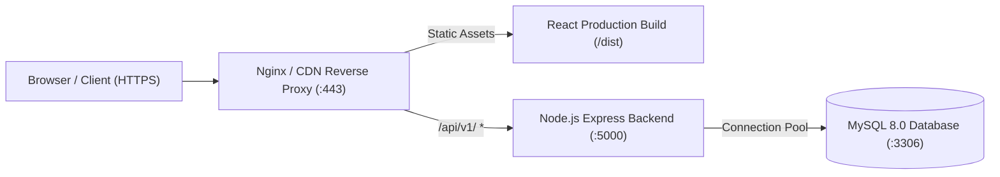

# MediConnect — Deployment Readiness & Production Operations Guide

This document defines the deployment architecture, configuration standards, operational safety gates, and rollback procedures for the MediConnect Emergency Blood Donation and Healthcare Coordination Platform.

---

## 1. System Architecture Overview

MediConnect operates as a secure, decoupled three-tier healthcare application:
1. **Frontend Presentation Tier:** React 18 + Vite SPA served via static CDN or Nginx reverse proxy.
2. **Backend API Tier:** Node.js + Express.js API service enforcing JWT authentication, RBAC, input validation, and audit logging.
3. **Database Tier:** MySQL 8.0+ relational database (`mediconnect_db`) configured in 3rd Normal Form with strict foreign keys and transactional row locks (`FOR UPDATE`).



---

## 2. Environment Variables Specification

### A. Backend (`backend/.env`)

| Variable | Description | Example (Development) | Production Requirement |
| :--- | :--- | :--- | :--- |
| `PORT` | API listener port | `5000` | Port assigned by container/host |
| `NODE_ENV` | Runtime environment | `development` | **`production`** |
| `API_PREFIX` | Versioned route mount | `/api/v1` | `/api/v1` |
| `DB_HOST` | MySQL hostname / IP | `127.0.0.1` | Managed DB private endpoint |
| `DB_PORT` | MySQL listener port | `3306` | `3306` |
| `DB_USER` | MySQL database user | `root` | Dedicated application user with restricted privileges |
| `DB_PASSWORD` | MySQL password | *empty* | High-entropy vault-managed secret |
| `DB_NAME` | Database schema name | `mediconnect_db` | `mediconnect_db` |
| `DB_CONNECTION_LIMIT` | Max pooled connections | `10` | Size based on server capacity (e.g. 25-50) |
| `JWT_SECRET` | Signing key for auth tokens | *dev-key* | **>= 64-char cryptographically random secret** |
| `JWT_EXPIRES_IN` | Token validity period | `8h` | `8h` |
| `CORS_ORIGIN` | Allowed origin whitelist | `http://localhost:3000` | **Exact production domain(s) (no wildcard)** |

### B. Frontend (`.env`)

| Variable | Description | Example (Development) | Production Requirement |
| :--- | :--- | :--- | :--- |
| `VITE_API_BASE_URL` | Base URL for REST API | `http://localhost:5000/api/v1` | `https://api.mediconnect.org/api/v1` |
| `VITE_APP_NAME` | Display name | `MediConnect` | `MediConnect` |

---

## 3. Database Backup & Restore Procedures

### Database Backup
A programmatic backup script is provided in `backend/scripts/create_backup.js`.
To generate a timestamped SQL dump:
```bash
cd backend
node scripts/create_backup.js
```
Alternatively, using native `mysqldump`:
```bash
mysqldump -u <db_user> -p --single-transaction --routines --triggers mediconnect_db > mediconnect_db_backup_$(date +%Y%m%d_%H%M%S).sql
```

### Database Restore
To restore from a verified backup:
```bash
mysql -u <db_user> -p mediconnect_db < backend/db/backups/<backup_file>.sql
```

---

## 4. Production Build & Verification

### Step 1: Run Test Suites
All backend integration tests and frontend unit tests must pass cleanly:
```bash
# Run backend test suite (43 integration tests)
npm run test:backend

# Run frontend test suite (40 unit & route tests)
npm test -- --run
```

### Step 2: Compile Optimized Frontend Assets
```bash
npm run build
```
The output will be placed in the `dist/` directory, ready for deployment via Nginx, AWS S3/CloudFront, Vercel, or Netlify.

### Step 3: Run Server Startup Check
```bash
node backend/tests/serverStartupCheck.js
```
This verifies database connectivity, health endpoints, demo role authentication, inactive user rejection, and donor privacy safeguards.

---

## 5. Security & Deployment Gate Checklist

Before promoting any build to staging or production, confirm each gate item:

- [x] **Zero plaintext passwords:** All passwords hashed with bcrypt (cost factor >= 10).
- [x] **Safe foreign keys:** Audit logs record unauthenticated attempts with `NULL` actor_user_id (no constraint violations).
- [x] **Statutory medical safeguards:** 5-infection TTI screening mandatory for unit release; automated bio-lock on reactive results.
- [x] **PII Privacy Shield:** Public donor discovery endpoints exclude phone, email, and exact date of birth.
- [x] **SQL Injection Defense:** 100% parameterized SQL queries (`?` placeholders).
- [x] **Cross-Origin Security:** CORS restricted to explicit whitelisted origins.
- [x] **HTTP Security Headers:** Helmet enabled with cross-origin policies.
- [x] **Database Backup:** Verified full database backup saved in `backend/db/backups/`.
- [x] **No Secrets Committed:** `.env` files gitignored; `.env.example` templates documented.

---

## 6. Rollback Procedure

If any anomaly occurs post-deployment:
1. **Frontend:** Point DNS or reverse proxy to the previous release bundle (`dist_previous/`).
2. **Backend:** Switch systemd service or container image tag back to the previous stable release.
3. **Database:** If a destructive migration occurred, execute the corresponding `.down.sql` migration or restore from the pre-deployment database backup:
   ```bash
   mysql -u <db_user> -p mediconnect_db < backend/db/backups/mediconnect_db_backup_2026-11-22T16-05-54-665Z.sql
   ```
4. **Smoke Test:** Execute `node backend/tests/serverStartupCheck.js` to confirm system recovery.
