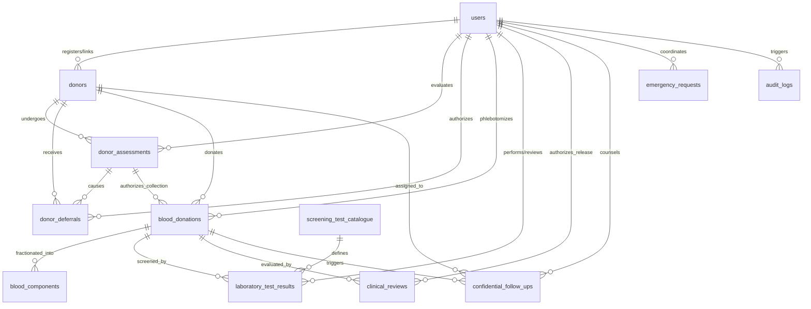

# MediConnect — Backend API & Database Architecture Documentation
**Phase 2: MySQL Database Integration & Node.js/Express Backend**  
**Standards Reference:** DGHS Standards for Blood Transfusion Services & WHO Screening Guidelines

---

## 1. Architecture Overview

MediConnect integrates a clean 3-tier enterprise architecture:
1. **Frontend Tier:** React + Vite + Tailwind CSS Single-Page Application (SPA). Communicates strictly over standard REST API via Axios (`src/services/api.js`). Never directly connects to MySQL or exposes database credentials.
2. **Backend API Tier:** Node.js + Express.js service (`backend/`). Provides route modularity, JWT authentication, server-side RBAC authorization, Zod schema validation, transaction management, and centralized error handling.
3. **Database Tier:** MySQL 8.0+ relational database (`mediconnect_db`) structured in 3rd Normal Form (3NF) with InnoDB engine, row-level locks (`FOR UPDATE`), foreign keys, and audit logging.

```mermaid
graph TD
    UI["React SPA (Vite / Tailwind)"] -->|HTTPS / REST API (JWT)| API["Node.js + Express API Server (:5000)"]
    
    subgraph "API Server Middleware & Safeguards"
        AUTH["authenticateToken (JWT)"]
        RBAC["requireRole (Server-Side RBAC)"]
        VAL["validateBody (Zod)"]
        SAFE["safetySafeguards (DGHS / WHO Rules)"]
    end
    
    API --> AUTH --> RBAC --> VAL --> SAFE
    SAFE --> TX["ACID Transactions (Row Locks)"]
    TX --> DB[("MySQL Database: mediconnect_db")]
```

---

## 2. Entity-Relationship Diagram (13 Tables)



---

## 3. Database Migrations & Synthetic Seed Data

### File Locations:
- Migration DDL: `backend/db/migrations/001_initial_schema.sql`
- Synthetic Seed Data: `backend/db/seeds/001_synthetic_seed_data.sql`
- Migration Runner: `backend/db/migrate.js`
- Seed Runner: `backend/db/seed.js`

### Commands:
```bash
# Run migration (creates mediconnect_db and 13 tables)
npm run backend:migrate

# Seed synthetic test records across all tables
npm run backend:seed
```

---

## 4. Server-Side Safety Safeguards

### A. Phlebotomy Collection Transaction
Executed atomically using database transactions:
1. `blood_donations` record is created in status `'Quarantined'` with reason: `"Mandatory post-collection safety quarantine pending laboratory screening"`.
2. 5 mandatory pending test records are automatically queued in `laboratory_test_results`:
   - `HIV` (HIV-1/2 4th Gen Ag/Ab)
   - `HBSAG` (HBsAg Hepatitis B)
   - `HCV` (Anti-HCV Hepatitis C)
   - `SYPHILIS` (TPHA / Syphilis Screen)
   - `MALARIA` (Malaria Parasite Antigen)

### B. Quarantine Bio-Lock Cascade
When any laboratory technician enters a `Reactive` result for any infectious disease test:
1. The test result is updated.
2. The associated blood donation unit immediately cascades into `'Bio_Lock'` status:
   `"BIO-LOCK: Mandatory quarantine due to reactive TTI screening result (<test_code>)"`.
3. The unit is permanently locked from clinical release.

### C. Clinical Disposition Release Verification
When a Transfusion Medicine Officer (`clinical_reviewer`) attempts to authorize release (`POST /api/v1/blood-safety/clinical-reviews`):
1. An exclusive row lock (`SELECT ... FOR UPDATE`) is acquired on the donation record.
2. The server verifies that **all 5 mandatory screening tests exist** and are **`Non-Reactive`**.
3. If any test is `Pending`, `Reactive`, `Inconclusive`, or `Invalid`, release is **strictly rejected** with HTTP `422 Unprocessable Entity` and the exact blocking reasons.
4. Only upon 100% negative verification is the unit updated to `'Released'`.

---

## 5. REST API Specification

### Authentication Endpoints (`/api/v1/auth`)
| Method | Endpoint | Description | Role / Auth |
| :--- | :--- | :--- | :--- |
| `POST` | `/api/v1/auth/login` | Authenticate user & issue signed JWT | Public |
| `GET` | `/api/v1/auth/me` | Retrieve profile of authenticated user | `Bearer JWT` |
| `GET` | `/api/v1/auth/demo-users` | Retrieve demo user profiles for testing | Public |

### Blood Safety Endpoints (`/api/v1/blood-safety`)
| Method | Endpoint | Description | Permitted Roles |
| :--- | :--- | :--- | :--- |
| `GET` | `/assessments` | List all donor assessments | All authenticated |
| `POST` | `/assessments` | Evaluate donor vitals and record assessment | `blood_bank_staff`, `admin` |
| `GET` | `/donations` | List donations (Role-filtered: hospitals see released only; donors see own only) | All roles |
| `GET` | `/donations/:unitNumber` | Get donation details + 5 screening test states | All roles |
| `GET` | `/donations/:unitNumber/prerequisites` | Server-evaluated release readiness check | All roles |
| `POST` | `/donations` | Phlebotomy accessioning transaction (unit + 5 pending tests) | `blood_bank_staff`, `admin` |
| `PUT` | `/donations/:unitNumber/quarantine` | Manual quarantine hold / update | `blood_bank_staff`, `clinical_reviewer`, `admin` |
| `GET` | `/lab-tests` | List all laboratory test results | All authenticated |
| `GET` | `/lab-tests/unit/:unitNumber` | List test results for specific donation unit | All authenticated |
| `PUT` | `/lab-tests/:resultId` | Record test outcome (triggers Bio-Lock if Reactive) | `lab_technician`, `admin` |
| `GET` | `/clinical-reviews` | List all clinical disposition decisions | All authenticated |
| `POST` | `/clinical-reviews` | Authorize unit release (Strict server-side validation) | `clinical_reviewer` ONLY |
| `GET` | `/follow-ups` | List confidential donor counseling cases | `clinical_reviewer`, `admin` |
| `PUT` | `/follow-ups/:caseId` | Update counseling status or confirmatory result | `clinical_reviewer`, `admin` |
| `GET` | `/audit-logs` | List immutable audit trail events | `admin`, `clinical_reviewer`, `blood_bank_staff` |

### Public & Hospital Endpoints
| Method | Endpoint | Description |
| :--- | :--- | :--- |
| `GET` | `/api/v1/donors` | Filtered donor search (bloodGroup, city) |
| `GET` | `/api/v1/campaigns` | Community donation drives |
| `GET` | `/api/v1/emergency-requests` | Hospital emergency blood requests |

---

## 6. Verification & Test Execution

### Backend Integration Tests (11 Test Scenarios):
```bash
cd backend
npm test
```
**Results:** 11 passed (100% success rate):
- Health check verification
- JWT issuance on credential validation
- Server-side DGHS donor vitals evaluation
- Mandatory deferral enforcement on low Hb (< 12.5 g/dL)
- Accessioning transaction with 5 mandatory pending lab tests
- Bio-Lock quarantine cascade on reactive test
- Release blockage when mandatory tests are pending or reactive (HTTP 422)
- Successful clinical release authorization for cleared negative units
- Role check enforcement (HTTP 403 on non-reviewer release attempt)
- Hospital coordinator view filtering (only released inventory visible, donor PII masked)
- Public donors and campaigns retrieval

### Frontend Unit & Integration Tests (38 Test Scenarios):
```bash
npm test
```
**Results:** 38 passed across 4 test suites:
- `src/test/bloodSafety.test.jsx` (16 tests)
- `src/test/donorSearch.test.jsx` (8 tests)
- `src/test/forms.test.jsx` (5 tests)
- `src/test/routes.test.jsx` (9 tests)

### Production Build Verification:
```bash
npm run build
```
**Results:** Build completed successfully in 8.82s.
