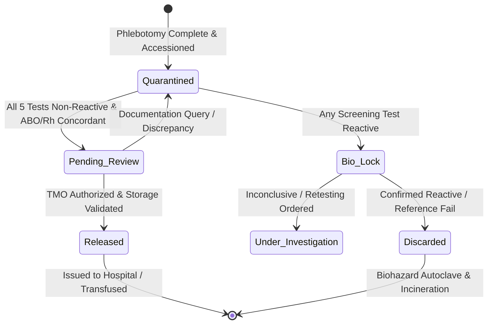

# MediConnect — Authoritative Healthcare Reference Dataset Specifications

> **Standard:** Real-World Production Reference Standards for Blood Transfusion Services  
> **Issuing Authorities:** Directorate General of Health Services (DGHS), National Blood Transfusion Council (NBTC), Ministry of Health & Family Welfare (MoHFW), World Health Organization (WHO)  
> **Document Location:** `docs/medical-references/authoritative-reference-data.md`  
> **Access & Audit Date:** November 22, 2026  
> **Strict Clinical Notice:** This reference compilation serves operational software alignment and training purposes. It does not replace independent on-site clinical judgment by licensed medical officers.

---

## 1. Controlled Regulatory Sources & Attribution Matrix

| Dataset Identifier | Domain | Source Organization | Authoritative Document / Reference | Publication / Revision Date | Access Date | Derived Operational Fields in MediConnect |
| :--- | :--- | :--- | :--- | :--- | :--- | :--- |
| **REF-ABO-01** | Blood Groups & Rh Antigens | WHO & NBTC India | *Standards for Blood Banks & Blood Transfusion Services* (NBTC / DGHS) | March 2020 | 2026-11-22 | `blood_group`, `antigen_summary`, `compatibility_matrix`, `population_prevalence` |
| **REF-CMP-02** | Blood Components & Storage | DGHS & WHO BTS | *DGHS Operational Guidelines on Voluntary Blood Donation*, Ch. 7: Component Separation & Storage | 2020 Amendment | 2026-11-22 | `component_type`, `volume_ml`, `storage_temperature_c`, `shelf_life_days`, `agitation_required` |
| **REF-SCR-03** | Statutory Screening Panel | Drugs & Cosmetics Rules (Part XII-B, Rule 122F) & WHO | *WHO Recommendations on Screening Donated Blood for TTIs* (Geneva) | 2009 / 2010 Edition | 2026-11-22 | `test_code`, `test_name`, `methodology`, `target_marker`, `mandatory_flag`, `cutoff_interpretation` |
| **REF-DEF-04** | Donor Deferral Taxonomy | WHO & DGHS India | *WHO Blood Donor Selection Guidelines* & DGHS Donor Fitness Protocol | 2012 / 2020 | 2026-11-22 | `category`, `type` (Temporary/Permanent), `period_days`, `statutory_rationale` |
| **REF-INV-05** | Inventory & Quarantine States | DGHS / NBTC | *Guidelines on Good Laboratory Practice (GLP) in Blood Banking* | 2020 | 2026-11-22 | `quarantine_status`, `transition_triggers`, `release_prerequisites`, `bio_lock_protocol` |
| **REF-EMG-06** | Emergency Prioritization | e-RaktKosh / AIIMS | *National e-RaktKosh Operational SOPs & Emergency Allocation* | 2022 Revision | 2026-11-22 | `urgency_level` (`Critical`, `Urgent`, `Normal`), `response_time_sla`, `allocation_rules` |

---

## 2. ABO & Rh Blood Group Classifications & Compatibility

Derived from **NBTC Standards & WHO Transfusion Protocols**.

| Blood Group | ABO Antigen | Rh(D) Antigen | Plasma Antibodies | Red Cell Compatibility (Can Receive From) | Red Cell Allocation (Can Donate To) | Demographic Prevalence (India Regional) |
| :--- | :--- | :--- | :--- | :--- | :--- | :--- |
| **O-** | Neither A nor B | Absent (Negative) | Anti-A, Anti-B | **O- only** | **All Groups (O-, O+, A-, A+, B-, B+, AB-, AB+)** *(Universal RBC Donor)* | ~1.5% - 2.0% |
| **O+** | Neither A nor B | Present (Positive)| Anti-A, Anti-B | O+, O- | O+, A+, B+, AB+ | ~36.5% - 38.0% |
| **A-** | A Antigen | Absent (Negative) | Anti-B | A-, O- | A-, A+, AB-, AB+ | ~0.8% - 1.2% |
| **A+** | A Antigen | Present (Positive)| Anti-B | A+, A-, O+, O- | A+, AB+ | ~21.0% - 23.5% |
| **B-** | B Antigen | Absent (Negative) | Anti-A | B-, O- | B-, B+, AB-, AB+ | ~1.8% - 2.5% |
| **B+** | B Antigen | Present (Positive)| Anti-A | B+, B-, O+, O- | B+, AB+ | ~32.0% - 34.5% *(Highest Prevalence in India)* |
| **AB-**| Both A and B | Absent (Negative) | None | AB-, A-, B-, O- | AB-, AB+ | ~0.4% - 0.7% *(Rarest ABO/Rh Group)* |
| **AB+**| Both A and B | Present (Positive)| None | **All Groups** *(Universal RBC Recipient)* | **AB+ only** *(Universal Plasma Donor)* | ~7.5% - 9.0% |

---

## 3. Blood Component Processing, Storage & Temperature Specifications

Derived from **DGHS Guidelines (Chapter 7) & Drugs & Cosmetics Act, Rule 122F**.

| Component Designation | Derived From | Standard Preparation Volume | Valid Storage Temperature | Anticoagulant / Preservative | Statutory Shelf Life | Special Handling / Quality Metrics |
| :--- | :--- | :--- | :--- | :--- | :--- | :--- |
| **Packed Red Blood Cells (PRBC)** | Whole Blood centrifugation | $250 - 320\text{ mL}$ | $2^\circ\text{C} - 6^\circ\text{C}$ | CPDA-1 / SAGM additive | **35 days** (CPDA-1) / **42 days** (SAGM) | Hematocrit $55\% - 75\%$; continuous digital cold-chain monitoring. |
| **Fresh Frozen Plasma (FFP)** | Centrifugation within 6h of phlebotomy | $200 - 250\text{ mL}$ | **$-30^\circ\text{C}$ or colder** (or $-18^\circ\text{C}$ to $-25^\circ\text{C}$) | Citrate-based | **12 months** (at $\le -30^\circ\text{C}$) | Factor VIII $\ge 0.7\text{ IU/mL}$; thawed at $37^\circ\text{C}$ in regulated water bath. |
| **Platelet Concentrate (RDP)** | Platelet-rich plasma from Whole Blood | $50 - 70\text{ mL}$ | **$20^\circ\text{C} - 24^\circ\text{C}$** | Plasma | **5 days** | **Mandatory continuous flatbed agitation** (60 strokes/min); pH $\ge 6.2$. |
| **Single Donor Platelets (SDP)** | Apheresis collection | $200 - 300\text{ mL}$ | **$20^\circ\text{C} - 24^\circ\text{C}$** | ACD-A | **5 days** | $\ge 3.0 \times 10^{11}$ platelets per unit; leukoreduced; continuous agitation. |
| **Cryoprecipitate** | Precipitate from slow thawing of FFP | $15 - 20\text{ mL}$ | **$-30^\circ\text{C}$ or colder** | Residual Plasma | **12 months** | Fibrinogen $\ge 150\text{ mg}$; Factor VIII $\ge 80\text{ IU}$ per bag. |

---

## 4. Statutory 5-Marker Infection Screening Panel (India Regulatory Mandate)

Under the **Drugs and Cosmetics Rules** and **DGHS Blood Safety Protocols**, no blood unit may be released without validated non-reactive testing across these 5 statutory markers:

| Marker Code | Target Pathogen | Statutory Test Methodology | Diagnostic Reagent Platform | Cutoff / Ratio Interpretation | Valid Control Validation |
| :--- | :--- | :--- | :--- | :--- | :--- |
| **HIV** | Human Immunodeficiency Virus Type 1 & 2 | 4th Gen Ag/Ab Combo (p24 Antigen + Anti-HIV-1/2 antibodies) | Chemiluminescent Immunoassay (CLIA / CMIA) or 4th Gen ELISA | S/CO $< 1.0$: **Non-Reactive** S/CO $\ge 1.0$: **Reactive** | Negative control OD $< 0.150$; Positive control OD $> 0.800$. |
| **HBSAG** | Hepatitis B Virus (Surface Antigen) | High-sensitivity HBsAg Sandwich EIA / CLIA | Microplate ELISA / Chemiluminescence | Cutoff index $< 1.0$: **Non-Reactive** $\ge 1.0$: **Reactive** | Sensitivity $\le 0.1\text{ IU/mL}$; run controls within $\pm 10\%$ CV. |
| **HCV** | Hepatitis C Virus | Anti-HCV Total Antibody (Core, NS3, NS4, NS5) | 3rd Generation ELISA / Microparticle EIA | S/CO $< 1.0$: **Non-Reactive** $\ge 1.0$: **Reactive** | Plate blank OD $< 0.05$; Positive control verified. |
| **SYPHILIS**| *Treponema pallidum* | Specific Treponemal Antibody (TPHA) or Non-Treponemal RPR | TPHA Hemagglutination / Micro-ELISA / RPR flocculation | Non-reactive: Clear circle / No agglutination | Known positive serum showing $3+/4+$ pattern; negative showing smooth button. |
| **MALARIA** | *Plasmodium falciparum* & *Plasmodium vivax* | Pan/Pf Antigen Immunochromatographic Assay & Blood Smear | Rapid Cassette Assay (pLDH / HRP-2) & Giemsa-stained thick/thin film | Negative: Control band only (no test band) | Control line must develop sharply within 15 min; thick smear examined under 100x oil immersion. |

---

## 5. Standardized Donor Deferral Taxonomy & Rationale

Derived from **WHO Blood Donor Selection (2012)** and **DGHS Operational Standards (2020)**.

| Deferral Category | Type | Minimum Duration | Clinical Rationale & Risk Factor |
| :--- | :--- | :--- | :--- |
| **Low_Hemoglobin** | Temporary | **90 days** | Hemoglobin $< 12.5\text{ g/dL}$; prevents iron-deficiency anemia in donor. |
| **Underweight** | Temporary | Until weight $\ge 45\text{ kg}$ | Weight $< 45\text{ kg}$ ($< 55\text{ kg}$ for 450 mL); avoids hypovolemic donor reactions. |
| **Hypertension** | Temporary | Until BP regulated | Systolic $> 140\text{ mmHg}$ or Diastolic $> 90\text{ mmHg}$; protects donor cardiovascular stability. |
| **Recent_Fever_Infection**| Temporary | **14 days** post-recovery | Transient bacteremia or viremia risk. |
| **Dental_Extraction** | Temporary | **72 hours (3 days)** | Transient oral bacteremia risk following tissue instrumentation. |
| **Antibiotic_Therapy** | Temporary | **14 days** post-last dose | Indicates unresolved bacterial infection; circulating antibacterial agents. |
| **Vaccination_Live** | Temporary | **28 days (4 weeks)** | Attenuated viremia risk (MMR, Yellow Fever, Oral Polio). |
| **Tattoo_Piercing_Acupuncture** | Temporary | **6 to 12 months** (DGHS: 12m) | Percutaneous exposure window for HBV, HCV, and HIV transmission. |
| **Major_Surgery** | Temporary | **12 months** | Surgical blood loss, tissue healing, or perioperative blood component receipt. |
| **Blood_Transfusion_Receipt** | Temporary | **12 months** | Risk of window-period TTI acquisition from prior donor unit. |
| **Travel_Malaria_Endemic** | Temporary | **3 months** post-return | Asymptomatic parasitemia risk from endemic geographic zone. |
| **Pregnancy_Lactation** | Temporary | **12 months** post-delivery | Maternal iron depletion and physiological volume recovery. |
| **TTI_Positive (Confirmed)** | Permanent | **Permanent Deferral** | Confirmed HIV, Hepatitis B (HBsAg), or Hepatitis C (Anti-HCV). |
| **High_Risk_Behavior** | Permanent | **Permanent Deferral** | Intravenous drug abuse or high-risk exposure precluding safe donation. |
| **Chronic_Systemic_Disease**| Permanent | **Permanent Deferral** | Severe cardiovascular disease, renal failure, malignancy, insulin-dependent diabetes. |

---

## 6. Blood Unit Quarantine Lifecycle & Safe Release Safeguards

### Statutory Release Safeguards (Server-Side Enforced)
1. **Mandatory 5-Test Completeness:** Unit cannot exit quarantine if any of `HIV`, `HBSAG`, `HCV`, `SYPHILIS`, or `MALARIA` is missing or `Pending`.
2. **Absolute Non-Reactive Rule:** If even one test is `Reactive` or `Inconclusive`, unit immediately transitions to `Bio_Lock` and release is blocked.
3. **ABO/Rh Double Verification:** Forward tube grouping (cells) and Reverse tube grouping (serum) must be 100% concordant.
4. **Active Expiry Window:** Current timestamp must be earlier than the component expiry timestamp.
5. **Exclusive TMO Authorization:** Only a certified user with role `clinical_reviewer` can authorize transition to `Released`.

---

## 7. Emergency Blood Request Prioritization SLA

Derived from **e-RaktKosh Hospital Transfusion Services Standards**.

| Urgency Level | Clinical Indication | Target Matching & Dispatch SLA | Protocol Constraints |
| :--- | :--- | :--- | :--- |
| **Critical** | Massive trauma, catastrophic hemorrhage, ruptured aortic aneurysm, acute obstetric hemorrhage | **Within 15 to 30 minutes** | Uncrossmatched O-Negative or immediate computer-assisted rapid crossmatch. |
| **Urgent** | Scheduled high-risk surgery, acute severe anemia ($\text{Hb} < 6.0\text{ g/dL}$ with cardiac decompensation), thrombocytopenia with active bleeding | **Within 2 to 4 hours** | Standard full serological crossmatch completed prior to release. |
| **Normal** | Elective surgical reserve, routine thalassemia transfusion schedule, stable oncology support | **Within 12 to 24 hours** | Scheduled batch allocation and crossmatch. |

---
*Authoritative Reference Specifications finalized for MediConnect operational data migration.*
