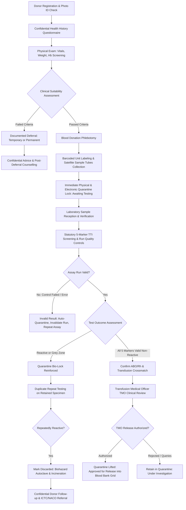

# Implementation Mapping: Blood Donor Selection, Screening & Safety

> **Document Status:** Authoritative Architectural Mapping for MediConnect Blood Safety Module  
> **Applicable Jurisdictions & Standards:**  
> - **India National Context:** Drugs & Cosmetics Act & Rules (amended March 2020), DGHS Operational Guidelines on Voluntary Blood Donation, National Blood Transfusion Council (NBTC) & National AIDS Control Organisation (NACO) Guidelines.  
> - **Global Context:** World Health Organization (WHO) Guidelines on Screening Donated Blood for Transfusion-Transmissible Infections (2009/2010), WHO Blood Donor Selection Guidelines (2012).  
> **Reference Directory:** `docs/medical-references/`

---

## 1. Controlled Reference Documents

| Filename | Full Title & Issuing Authority | Publication / Edition | Core Mandate & Implementation Scope |
| :--- | :--- | :--- | :--- |
| `dghs-guidelines.pdf` | **Voluntary Blood Donation: An Operational Guideline** *Directorate General of Health Services (DGHS), Blood Transfusion Services (BTS) Division, Ministry of Health & Family Welfare (MoHFW), Government of India / NBTC* | March 2020 Amendment & Operational Protocols | Statutory donor eligibility parameters (age, weight, Hb, interval), mandatory 5-infection testing panel in India, e-RaktKosh data alignment, and camp management. |
| `who-blood-screening.pdf` | **Screening Donated Blood for Transfusion-Transmissible Infections: Recommendations** *World Health Organization (WHO), Blood Transfusion Safety, Geneva* | 2009 / 2010 Edition | 100% quality-assured testing, assay validation, duplicate retesting algorithms for initial reactives, run validity controls, and quarantine containment. |
| `who-donor-selection.pdf` | **Blood Donor Selection: Guidelines on Assessing Donor Suitability for Blood Donation** *World Health Organization (WHO), Geneva* | 2012 Edition | Evidence-based medical questionnaire structure, temporary vs. permanent deferral taxonomy, donor privacy, informed consent, and post-donation counselling. |

---

## 2. Regulatory Medical Eligibility Criteria (DGHS & WHO Standards)

In strict accordance with the DGHS Operational Guidelines and Drugs & Cosmetics Rules, the system enforces the following clinical rules:

### A. Vital Signs & Physical Examination Thresholds
- **Age:** 18 to 65 years. (First-time donors strictly up to 60 or 65 as clinically permitted by local medical officer).
- **Weight:**
  - $\ge 45\text{ kg}$ for standard $350\text{ mL}$ whole blood collection ($\pm 10\%$).
  - $\ge 55\text{ kg}$ for standard $450\text{ mL}$ whole blood collection ($\pm 10\%$).
- **Hemoglobin Level:** Minimum $12.5\text{ g/dL}$ (hematocrit $\ge 38\%$), measured prior to phlebotomy.
- **Pulse Rate:** 60 to 100 beats per minute, regular rhythm without significant ectopic beats.
- **Blood Pressure:**
  - Systolic: $100\text{ mmHg} - 140\text{ mmHg}$.
  - Diastolic: $60\text{ mmHg} - 90\text{ mmHg}$ (without antihypertensive medications).
- **Body Temperature:** Normal oral temperature not exceeding $37.5^\circ\text{C}$ ($98.6^\circ\text{F}$); afebrile with no acute infection.
- **Venipuncture Site:** Free from lesions, rashes, boils, scars of repeated injections, or phlebitis.

### B. Mandatory Donation Intervals
- **Whole Blood (Male):** Minimum interval of 90 days (3 months) between consecutive whole blood donations.
- **Whole Blood (Female):** Minimum interval of 120 days (4 months) between consecutive whole blood donations.
- **Plateletpheresis (Single Donor Platelets - SDP):** Minimum 48 hours between procedures; maximum 2 times in 7 days; not exceeding 24 times in a calendar year.

### C. Standardized Deferral Classification

#### Temporary Deferral Periods:
1. **Dental Extraction / Minor Dental Surgery:** 72 hours (3 days).
2. **Alcohol Consumption:** Minimum 12 to 24 hours prior to donation (must be sober and free from intoxication).
3. **Prescription Antibiotics:** 14 days after completion of the course and complete symptom resolution.
4. **Vaccinations:**
   - Inactivated vaccines / Toxoids (Tetanus, COVID-19 mRNA/inactivated): 24–48 hours if symptom-free.
   - Live attenuated vaccines (MMR, Yellow Fever, Oral Polio): 4 weeks (28 days).
   - Rabies post-exposure prophylaxis: 1 year (12 months).
5. **Tattoos, Body Piercing, Acupuncture, Needlestick Injury:** 6 to 12 months (standard DGHS protocol: 12 months; modernized WHO minimum: 6 months).
6. **Major Surgery:** 6 to 12 months depending on healing and blood transfusion receipt.
7. **Blood or Blood Component Transfusion (Recipient):** 12 months.
8. **Malaria Endemic Travel / Treated Malaria:** 3 months post-travel or 3 months post-curative treatment.
9. **Typhoid Fever:** 12 months after full clinical recovery.
10. **Pregnancy & Lactation:** Defer during pregnancy and for 12 months post-delivery or cessation of lactation.

#### Permanent Deferral Conditions:
1. Evidence or confirmed medical history of HIV-1 or HIV-2 infection.
2. Evidence or history of Hepatitis B or Hepatitis C infection (confirmed HBsAg or Anti-HCV positive).
3. Chronic cardiac failure, ischemic heart disease, severe hypertension, or cerebrovascular accident.
4. Chronic kidney disease / renal impairment.
5. Malignancy (solid organ cancer, leukemia, lymphoma).
6. Active autoimmune disorders or systemic endocrine collapse.
7. Insulin-dependent Diabetes Mellitus.
8. History of intravenous recreational drug abuse or high-risk behavioral exposure for TTIs.
9. Creutzfeldt-Jakob Disease (CJD) risk or human pituitary growth hormone treatment.

---

## 3. Statutory Infection Screening Protocol (India Mandate & WHO)

Under the Drugs and Cosmetics Act & NBTC regulations, **no unit of donated blood may be released for clinical transfusion** until it is individually tested and confirmed **Non-reactive** for the following 5 statutory markers:

| Marker Code | Target Pathogen | Statutory Test Method | Reagent / Platform Class | Standard TAT |
| :--- | :--- | :--- | :--- | :--- |
| `SCR-HIV` | HIV-1 & HIV-2 | 4th Generation ELISA / CLIA (Antibody + p24 Antigen) | Validated microplate / Chemiluminescence immunoassay | 180 min |
| `SCR-HBV` | Hepatitis B Virus | Hepatitis B Surface Antigen (HBsAg) ELISA / CLIA | High-sensitivity micro-ELISA | 120 min |
| `SCR-HCV` | Hepatitis C Virus | Anti-HCV Total Antibody ELISA / CLIA | 3rd generation structural/non-structural peptide EIA | 120 min |
| `SCR-SYPH` | *Treponema pallidum* (Syphilis) | RPR Flocculation / TPHA / Immunoassay | Agglutination or Micro-ELISA | 60 min |
| `SCR-MAL` | Malaria Parasite | Rapid Diagnostic Test (Pan/Pf Antigen) & Peripheral Blood Smear | Immunochromatographic cassette & Giemsa smear | 45 min |
| `SCR-NAT` *(Supplementary)* | HIV-1 RNA, HBV DNA, HCV RNA | Individual Donor Nucleic Acid Testing (ID-NAT) | Multiplex Real-Time PCR (ultra-early window closure) | 240 min |

---

## 4. End-to-End Safety Workflow Architecture

---

## 5. Blood Unit Quarantine & Authorized Release Rules

1. **Default Fail-Safe State:**
   - Every collected donation unit is assigned the disposition status `Awaiting testing` and locked in electronic and physical quarantine upon creation.
   - It cannot be allocated to a hospital, assigned to a patient, or dispatched under any circumstances while in this state.

2. **Automated Quarantine Locks:**
   - If any test result is marked `Reactive`, `Inconclusive`, or `Invalid`, the disposition status immediately shifts to `Quarantined` or `Under investigation`.
   - The system triggers an audible and visual warning in the blood bank inventory system and prevents physical label generation for release.

3. **Statutory Release Prerequisites:**
   To transition a unit from `Quarantined` / `Awaiting testing` to `Approved for release`, **all** of the following prerequisites must evaluate to `TRUE`:
   - [x] Donor health assessment completed with outcome `Accepted for donation`.
   - [x] All 5 statutory screening tests (`SCR-HIV`, `SCR-HBV`, `SCR-HCV`, `SCR-SYPH`, `SCR-MAL`) completed with result status `Non-reactive`.
   - [x] All test runs confirmed `Valid` (negative and positive reagent controls strictly verified).
   - [x] Both Forward and Reverse ABO/Rh blood grouping performed and fully concordant.
   - [x] Unit expiration timestamp is in the future.
   - [x] Storage temperature log verified within continuous cold chain limits ($2^\circ\text{C} - 6^\circ\text{C}$ for RBCs; $-30^\circ\text{C}$ for FFP; $20^\circ\text{C} - 24^\circ\text{C}$ agitated for Platelets).
   - [x] Final electronic release authorization signed by an authenticated **Transfusion Medical Officer (TMO)**.

4. **Role Boundary Enforcement:**
   - Blood Bank Staff, Laboratory Technologists, Hospital Coordinators, Donors, and IT Administrators **cannot** sign off on clinical unit release. Only licensed TMOs hold this permission.

---

## 6. Confidential Data & Privacy Architecture

In compliance with medical ethics, NACO/NBTC guidelines, and statutory privacy mandates:

| Data Category | Specific Data Fields | Access Restrictions & Protection Model |
| :--- | :--- | :--- |
| **Donor Identifiable Information (PII)** | National ID, Full Name, Phone, Residential Address, Email, Photo | Restricted to Donor Selection Staff and Registration Desk. Encrypted at rest. Never visible to Hospital Requesters. |
| **Confidential Health History** | Questionnaire responses (sexual history, STI symptoms, substance history, menstrual history) | Accessible only to Assessing Medical Officer during pre-donation screening. Sealed post-assessment. |
| **Reactive TTI Screening Results** | Optical density (OD) ratios, specific reactive pathogen markers, confirmatory status | Strictly restricted to TMO, Laboratory In-Charge, and Designated Counsellor. Never published to public dashboard or hospital screens. |
| **Post-Test Counselling Records** | ICTC referral letters, counselling notes, partner notification status | Available only on the confidential `ConfidentialFollowUpPage` to authorized clinical reviewers. |
| **Released Unit Inventory View** | Blood Unit ID, ABO/Rh Blood Group, Component Type, Expiry Date | Fully anonymized for Hospital Blood Coordinators; zero link back to donor identity. |

---

## 7. Laboratory Test Result Scenarios & System Reactions

| Scenario | Result State | Optical Density / Cutoff (OD/CO) | System Action | Unit Disposition | Follow-Up Trigger |
| :--- | :--- | :--- | :--- | :--- | :--- |
| **1. Normal Clear** | `Non-reactive` | $\text{Ratio} < 0.8$ (Well below cutoff) | Test marked pass. If all 5 pass, unit advances to pre-release queue. | `Awaiting testing` $\to$ eligible for TMO review | None required |
| **2. Initial Reactive** | `Reactive` | $\text{Ratio} \ge 1.0$ (Above threshold) | Immediate quarantine lock. Split components locked. Retest in duplicate ordered. | `Quarantined` | TMO notified; initiate repeat testing algorithm |
| **3. Borderline / Grey Zone** | `Inconclusive` | $0.8 \le \text{Ratio} < 1.0$ (Indeterminate band) | Bio-lock active. Test cannot be marked pass. Requires duplicate repeat assay or molecular testing. | `Under investigation` | Laboratory lead escalation; supplementary NAT/blot |
| **4. Run Failure / Error** | `Invalid` | Internal/External Controls out of bounds, clot, bubble, or expired kit | Run invalidated immediately. Cannot be used for disposition. Sample must be redrawn/retested. | `Awaiting testing` / `Quarantined` | Lab deviation log created; CAPA triggered if recurrent |
| **5. Clinical Sign-Off** | `Reviewed` / `Approved` | TMO verifies complete non-reactive panel and checks documentation | Quarantine lock removed. Barcoded release label printed. Unit transferred to available stock. | `Approved for release` | Unit visible on MediConnect hospital request grid |
| **6. Confirmed Positive** | `Discarded` | Repeatedly reactive or confirmed by reference lab | Unit permanently decommissioned. Biological waste protocol triggered. Autoclave log logged. | `Discarded` | Donor registered in national confidential deferral registry; ICTC referral |

---

## 8. Alignment with Existing MediConnect Codebase

The architecture mapped above is directly integrated with:
- **Service Layer:** `src/services/bloodSafetyService.js` enforcing clinical checks and immutable audit logging.
- **Frontend Pages:** `src/pages/bloodSafety/*` (Assessment, Testing, Quarantine, Review, Follow-Up, Audit).
- **Authentication Context:** `src/context/SafetyAuthContext.jsx` implementing strict role switching for demonstration.
- **Mock Data Registry:** `src/data/bloodSafetyData.js` providing realistic, standards-compliant clinical scenarios.
- **Test Suite:** `src/test/bloodSafety.test.jsx` verifying all 5 mandatory screening markers and quarantine release locks.
